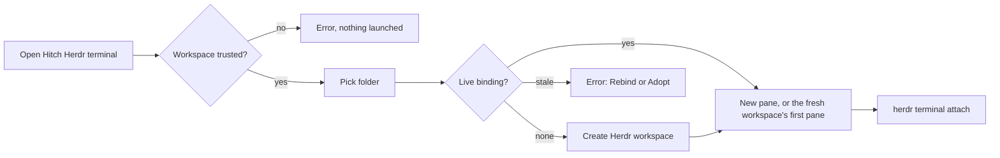

# Hitch

VS Code/Cursor extension (workspace extension kind) that opens a terminal attached to a Herdr pane.

## Install

1. Install `herdr` (on `PATH` or in `$HOME/.local/bin`).
2. `npm ci && npm run build && npm run package`, then install `hitch-0.1.0.vsix` (`Extensions: Install from VSIX...`).

## Use

Open a terminal with the **Hitch Herdr** profile. The extension checks Workspace Trust, picks the workspace folder
(active editor's folder, the sole folder, or a picker), binds it to a Herdr workspace, opens a pane, and attaches with
`herdr terminal attach <terminal_id>` (never `--takeover`).

For the Split Terminal command to use it, set:

```json
"terminal.integrated.defaultProfile.linux": "Hitch Herdr"
```

Failures show an error message; there is no fallback shell.

## Limitations

- Only human-opened terminals; the Cursor Agent shell is not routed.
- No shell integration: no cwd tracking or exit-status detection.
- Busy-controller detection is not implemented (`herdr pane get` exposes no attach/controller field).
- Tested on Linux workspace hosts only (no OS check); untrusted workspaces are refused.
- Multi-root windows are unit-tested only; the folder picker has not been exercised by hand in Cursor.

## Cursor Remote
Hitch runs on the workspace host, not the client. With Cursor on a Mac connected over Remote SSH to a Linux machine, Hitch and Herdr both live on the Linux machine; the Mac only displays the terminal. See `docs/compat.md`.

## How a terminal opens



## Companion (Herdr plugin)
`herdr-plugin.toml` declares a read-only `diagnose` action (`node dist/companion.js`, build with `npm run build:companion`). It uses the focused pane cwd or `--project <dir>`.

## Verify and roll back
```sh
npm run typecheck && npm test && npm run build && npm run package
HITCH_PRIVATE_STRINGS=<host,alias> node scripts/check-vsix.mjs hitch-0.1.0.vsix
scripts/lifecycle.sh <code-or-cursor-server-cli> hitch-0.1.0.vsix   # install, upgrade, uninstall in a throwaway dir
```

These do not replace manual Cursor acceptance. Rollback: uninstall the extension and remove the default-profile setting. See `docs/compat.md` for tested versions and gaps.

## Notes
- If a pane already has an attached client, herdr's own "already has an attached client" message appears in the terminal; Hitch never takes over.
- `Hitch: Reattach to Herdr Pane` opens a terminal on an existing pane of the project's workspace.
- `Hitch: Rebind Project to New Herdr Workspace` recovers when the bound workspace was closed or the Herdr server restarted. It never runs automatically and never touches the old workspace.
- `Hitch: Adopt Existing Herdr Workspace` binds the project to a workspace you pick, for example after an interrupted bind. It asks for confirmation and changes no workspace.
- Untrusted workspaces are not supported (Hitch spawns Herdr processes).
